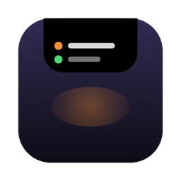
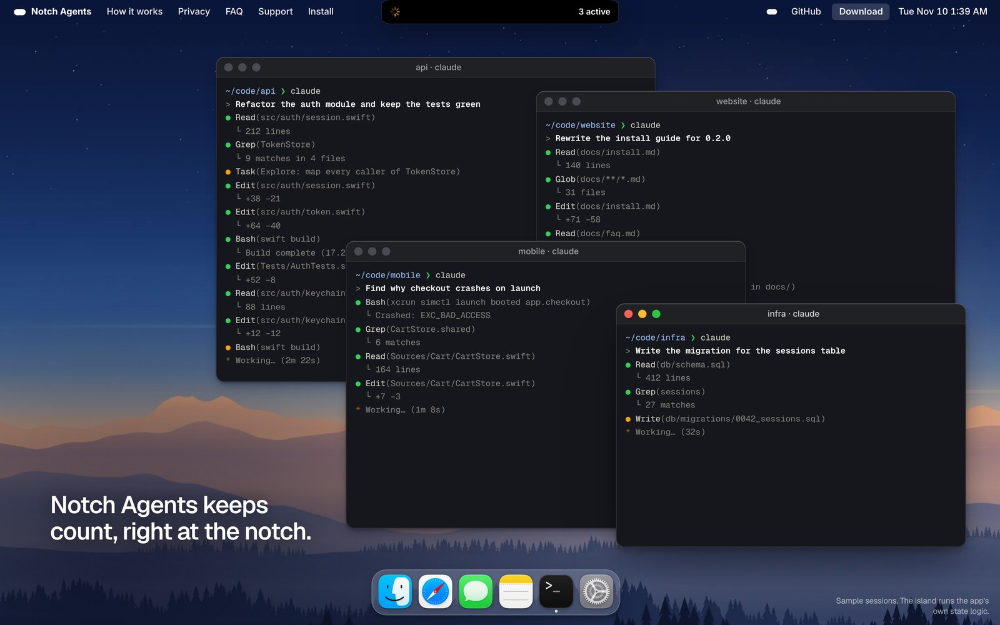
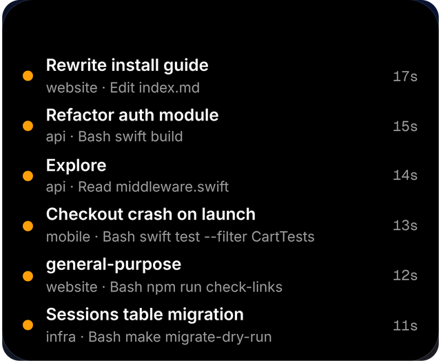
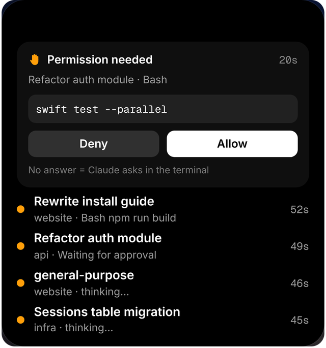
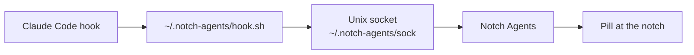

<p align="center">
  
</p>

<h1 align="center">Notch Agents</h1>

<p align="center">
  <em>Every Claude Code agent, live at your notch.</em>
</p>

<p align="center">
  <a href="https://github.com/adii9/notch-agents/releases/latest"></a>
</p>

<p align="center">
  <a href="https://github.com/adii9/notch-agents/stargazers"></a>
  <a href="https://github.com/adii9/notch-agents/releases"></a>
  <a href="https://github.com/adii9/notch-agents/actions/workflows/ci.yml"></a>
  
  <a href="LICENSE"></a>
</p>

<p align="center">
  <a href="https://notch-agents.vercel.app"><strong>Website</strong></a> &middot;
  <a href="https://github.com/adii9/notch-agents/releases/latest"><strong>Download</strong></a> &middot;
  <a href="#install"><strong>Install</strong></a> &middot;
  <a href="#faq"><strong>FAQ</strong></a>
</p>

<p align="center">
  
  <br>
  <sub>Four Claude Code sessions, one pill at the notch. Shot from the live demo on the website.</sub>
</p>

<p align="center">
  <sub>⭐ If it saves you a trip to the terminal, <a href="https://github.com/adii9/notch-agents">star the repo</a> so other Claude Code users can find it.</sub>
</p>

---

Notch Agents puts a Dynamic-Island-style pill at the top of your Mac. It shows every running [Claude Code](https://claude.com/claude-code) session and sub-agent: which one is working, on what, for how long, and which one is waiting for you. When Claude needs permission, the island asks, and you answer with one click.

Free, open source, and it never talks to the network.

> Independent project. Not affiliated with or endorsed by Anthropic.

## What it does

<p align="center">
  
  &nbsp;&nbsp;
  
  <br>
  <sub><strong>Left:</strong> every session and sub-agent, with its tool and timer. <strong>Right:</strong> approve a permission without finding the terminal.</sub>
</p>

- **One row per chat.** Each session carries its chat title and project folder. Sub-agents get rows of their own and turn green when they finish.
- **Live tool and timer.** See the tool and file each agent is on right now, and how long it has run.
- **Approve from the notch.** When Claude asks for permission, the island opens with the exact command or file and Allow and Deny buttons. Don't answer within 25 seconds and Claude asks in the terminal as usual.
- **Out of the way.** A compact pill wraps the notch with a spinner and the active count. Hover to expand it. A few seconds after everything finishes, it tidies itself away.
- **Private.** No network code, events held in memory, one local socket only your account can read.

It works on Macs without a notch too: the pill sits at the top centre of the screen.

## Install

Requires macOS 14 or later, Apple silicon or Intel.

1. **Download** the latest `.dmg` from [Releases](https://github.com/adii9/notch-agents/releases/latest), open it and drag **Notch Agents** into Applications.
2. **Open it.** This build is not notarized yet, so macOS will refuse the first time. Right-click the app in Applications, choose **Open**, then confirm. (On macOS 15 or later: System Settings → Privacy & Security → **Open Anyway**.) A capsule icon appears in the menu bar.
3. **Install the hooks.** Choose **Install Claude Code hooks…** from that icon and confirm. Then restart any running Claude Code sessions, because sessions started earlier don't pick up new hooks.
4. **Work as usual.** The pill appears as soon as an agent starts working.

Prefer to build it yourself? See [Build from source](#build-from-source).

## How it works



Claude Code fires a hook when a session starts, uses a tool, starts or stops a sub-agent, asks for permission, finishes, or sends a notification. Notch Agents installs a small script for eight of them:

`SessionStart` · `PreToolUse` · `PostToolUse` · `SubagentStart` · `SubagentStop` · `Stop` · `Notification` · `PermissionRequest`

- For every event except permission requests, the script writes the event JSON to the socket and exits 0 straight away, even if the app isn't running. It can't hold Claude up.
- For a `PermissionRequest`, the script waits for your Allow or Deny and prints the answer back to Claude. No answer within 25 seconds, or no app running, prints nothing, and Claude shows its own prompt.
- Questions Claude asks you (`AskUserQuestion`) appear on the island as a heads-up. You answer them in the terminal, because Allow and Deny can't pick an option.

Where to look in the code:

| File | What it does |
|------|--------------|
| [`AgentStore.swift`](Sources/NotchAgents/AgentStore.swift) | Turns hook events into sessions, sub-agents and pending prompts |
| [`EventServer.swift`](Sources/NotchAgents/EventServer.swift) | The local socket (mode 0600) |
| [`HookInstaller.swift`](Sources/NotchAgents/HookInstaller.swift) | The hook script and the `settings.json` edits |
| [`IslandView.swift`](Sources/NotchAgents/IslandView.swift) | The pill, the expanded island and the permission card |
| [`App.swift`](Sources/NotchAgents/App.swift) | The panel at the notch and click-through handling |

## What install changes

**Install Claude Code hooks…** edits `~/.claude/settings.json`. It writes a timestamped backup first (`settings.json.bak.<unix-time>`) and only adds entries that point at `~/.notch-agents/hook.sh`. **Remove Claude Code hooks** reverses it. To uninstall completely, remove the hooks, quit the app and delete it from Applications.

## FAQ

<details>
<summary><strong>Can it slow down or break Claude Code?</strong></summary>

No. Normal events are handed to a local socket and the script exits at once. The one exception is a permission request, which waits up to 25 seconds for your answer, then falls back to Claude's own prompt.
</details>

<details>
<summary><strong>Does it send my code or prompts anywhere?</strong></summary>

No. The app has no network code. Events live in memory and the app never writes them to disk. The socket is readable only by your user account.
</details>

<details>
<summary><strong>macOS says it can't verify the app.</strong></summary>

The build isn't notarized yet. Right-click the app, choose Open, and confirm. Or build it from source below.
</details>

<details>
<summary><strong>Nothing shows up at the notch.</strong></summary>

Check that the app is running (capsule icon in the menu bar), that the hooks are installed, and that you restarted your Claude Code sessions afterwards.
</details>

<details>
<summary><strong>Is this an official Anthropic product?</strong></summary>

No. It's an independent open-source project. "Claude" is a trademark of Anthropic.
</details>

## Build from source

```bash
swift build && .build/debug/NotchAgents     # run
Scripts/simulate.sh                         # fake multi-agent activity, no Claude needed
Scripts/build-app.sh                        # dist/Notch Agents.app + .dmg (ad-hoc signed)
```

For a signed, notarized build set `SIGN_IDENTITY="Developer ID Application: …"` and `NOTARY_PROFILE=<notarytool keychain profile>`.

CI builds every push and PR, checks the scripts and runs `Scripts/test-hook.sh`. Pushing a `v*` tag builds the DMG, adds `SHA256SUMS.txt` and publishes a release. Signing and notarization switch on automatically when these repo secrets exist: `MACOS_CERT_P12`, `MACOS_CERT_PASSWORD`, `APPLE_ID`, `APPLE_TEAM_ID`, `APPLE_APP_PASSWORD`. Without them, releases are ad-hoc signed.

## Contributing

Issues and pull requests are welcome. See [CONTRIBUTING.md](CONTRIBUTING.md). Ideas wanted: click-to-focus the terminal, sounds, a settings window, a layout for Macs without a notch.

<details>
<summary><strong>The website (for maintainers)</strong></summary>

<br>

Live at **https://notch-agents.vercel.app**. Vercel deploys the static `docs/` folder on every push to `main`, with no build step.

- `docs/index.html`, `site.css`, `site.js` are the page. The island on it runs a JavaScript port of `AgentStore.swift` fed with hook events of the real shape. If you change how the app handles an event, mirror it in `site.js`.
- `docs/scrollcraft.js` and `scrollcraft.css` are the [scroll-craft](https://github.com/nateherkai/scroll-craft) engine, unmodified. Fonts are self-hosted. Licences are in `docs/THIRD-PARTY.md`.
- Preview locally: `python3 -m http.server -d docs 4500`.

**Payments (optional support, Razorpay).** `docs/api/` holds two dependency-free Vercel functions, `create-order` and `verify`.
- Set `RAZORPAY_KEY_ID` and `RAZORPAY_KEY_SECRET` in the Vercel project settings. Use `rzp_test_` keys for Preview and `rzp_live_` keys for Production. Never commit them. Without them the Pay button says payments aren't switched on yet.
- The price lives in `AMOUNT_PAISE` in `docs/api/_razorpay.js`. The page text in `index.html` must be changed to match.
- The server decides the amount, and Razorpay's checkout script loads only when someone presses Pay.
</details>

## License

[MIT](LICENSE). The icons in `docs/assets/dock/` are Apple's and are not covered by it. See [`docs/THIRD-PARTY.md`](docs/THIRD-PARTY.md).

## Star history

<a href="https://www.star-history.com/adii9/notch-agents#history">
  <picture>
    <source media="(prefers-color-scheme: dark)" srcset="https://api.star-history.com/chart?repos=adii9/notch-agents&type=Date&theme=dark" />
    <source media="(prefers-color-scheme: light)" srcset="https://api.star-history.com/chart?repos=adii9/notch-agents&type=Date" />
    
  </picture>
</a>

<p align="center">
  <sub>If Notch Agents is useful to you, <a href="https://github.com/adii9/notch-agents">a ⭐ on GitHub</a> is the best way to say so.</sub>
</p>
